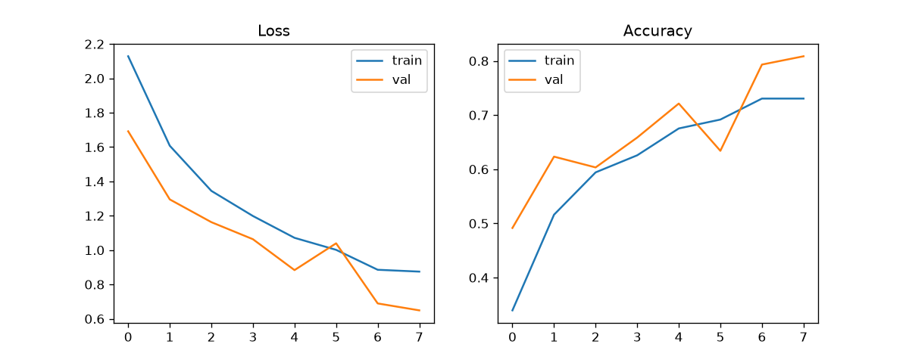
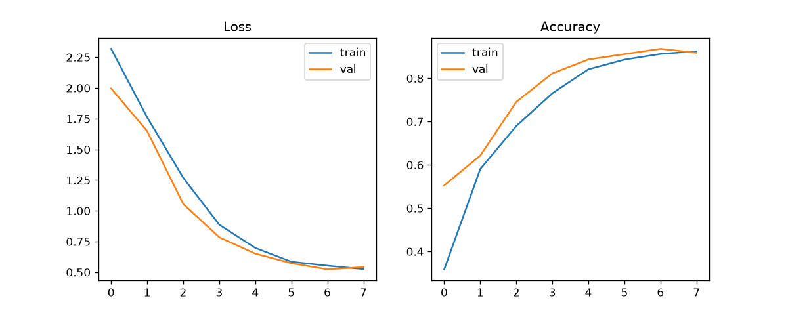
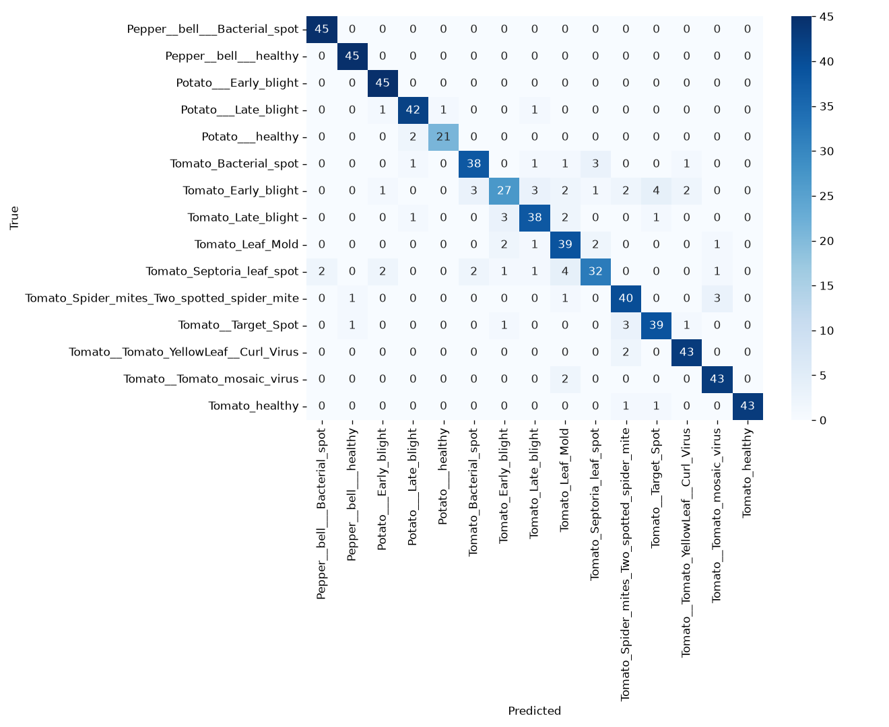
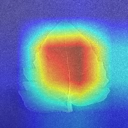

# 🌿 LeafDoc: Plant Disease Detection from Leaf Photos

A farmer takes a photo of a leaf and instantly sees the likely disease, a confidence score, a Grad-CAM heatmap showing where the model looked, and treatment advice in **English and Urdu**. If the model is unsure, or the image is not a leaf, it says so instead of guessing.

**Live demo:** https://leafdoc-kp4f2jduref7gxamctir5r.streamlit.app/
**GitHub:** https://github.com/muhammadahmadhoperevival-spec/leafdoc
**Demo video:** https://www.awesomescreenshot.com/video/57817785?key=e89684276d06aafa361c4259535035fc

## Problem

Farmers lose a large part of their crops to diseases that are recognised too late. LeafDoc is a quick decision aid. It is not a replacement for an agriculture expert.

## Dataset

[PlantVillage](https://www.kaggle.com/datasets/emmarex/plantdisease) (Kaggle), restricted to **tomato, potato and pepper** (15 classes).

- Exact duplicate images were removed by MD5 hash.
- At most 300 images per class were used, to keep CPU training practical.
- Final size: **4,352 images**, split **by image** into train 3,046 / val 653 / test 653 (stratified).
- The split script asserts that no image hash appears in more than one split.

PlantVillage does not contain cotton, so cotton is not supported.

## Approach

1. **Baseline:** small CNN from scratch (4 conv blocks with BatchNorm, pooling, dropout), 8 epochs, with augmentation (flip, rotation, colour jitter).
2. **Transfer learning:** pretrained ResNet18 (timm). 2 epochs with the backbone frozen, then full fine-tuning with a cosine LR scheduler and early stopping.
3. **Evaluation:** confusion matrix, per-class accuracy, confidence-threshold analysis.
4. **Explainability:** Grad-CAM on the last ResNet block.
5. **Safety logic:** a colour-based leaf check (rejects non-leaf images) and a confidence threshold of 0.6 (below it the app answers "Not sure").
6. **App:** Streamlit, deployed on Streamlit Community Cloud (a Gradio version is included for local use).

Images are resized to 128x128 so training runs on a CPU.

## Results (test set, 653 images)

| Model | Test accuracy |
|---|---|
| Small CNN (scratch) | 82.2% |
| ResNet18 (transfer learning) | **88.8%** |

Transfer learning beats the scratch baseline by about 6.6 points.

### Training curves




### Confusion matrix



### Per-class accuracy (ResNet18)

| Class | Accuracy | Test images |
|---|---|---|
| Tomato Early blight | 0.600 | 45 |
| Tomato Septoria leaf spot | 0.711 | 45 |
| Tomato Late blight | 0.844 | 45 |
| Tomato Bacterial spot | 0.844 | 45 |
| Tomato Leaf Mold | 0.867 | 45 |
| Tomato Target Spot | 0.867 | 45 |
| Tomato Spider mites | 0.889 | 45 |
| Potato healthy | 0.913 | 23 |
| Potato Late blight | 0.933 | 45 |
| Tomato Yellow Leaf Curl Virus | 0.956 | 45 |
| Tomato healthy | 0.956 | 45 |
| Tomato mosaic virus | 0.956 | 45 |
| Pepper bell healthy | 1.000 | 45 |
| Pepper bell Bacterial spot | 1.000 | 45 |
| Potato Early blight | 1.000 | 45 |

The weakest classes are tomato Early blight and Septoria leaf spot, which look similar to other blight and spot diseases.

### "Not sure" threshold

| Confidence threshold | Images answered | Accuracy on answered |
|---|---|---|
| 0.0 | 100.0% | 88.8% |
| 0.5 | 80.9% | 96.2% |
| **0.6 (used)** | 72.4% | 97.0% |
| 0.7 | 58.8% | 99.0% |
| 0.8 | 44.0% | 99.7% |
| 0.9 | 27.1% | 100.0% |

Raising the threshold makes answers more reliable but sends more images to "Not sure". Some correctly classified images from weak classes also fall below 0.6, so the app errs on the side of caution.

### Grad-CAM

In the examples checked, the heatmaps concentrate on the leaf rather than the background.



## App behaviour

- **Leaf photo, confident (>= 60%):** disease name, confidence, heatmap, English + Urdu advice.
- **Low confidence (< 60%):** "Not sure" message in English and Urdu, with a tip to retake the photo.
- **Not a leaf (e.g. a coin):** "This does not look like a leaf photo", no prediction.
- Photos can be uploaded or taken with the device camera.

## Project structure

```
streamlit_app.py   # deployed Streamlit app (single file)
tl_model.pth       # final ResNet18 weights
classes.json       # class names
requirements.txt   # dependencies for the deployed app
src/
  make_splits.py   # dedup + leak-free split
  dataset.py       # Dataset, augmentation
  train_cnn.py     # scratch baseline
  train_tl.py      # transfer learning
  evaluate.py      # confusion matrix, per-class accuracy, thresholds
  predict.py       # inference, Grad-CAM, not-sure logic
  advice.py        # English + Urdu advice
app/app.py         # Gradio version (local use, needs: pip install gradio)
```

## How to run

```bash
git clone https://github.com/muhammadahmadhoperevival-spec/leafdoc
cd leafdoc
pip install -r requirements.txt

# Run the app with the included model
streamlit run streamlit_app.py
```

To retrain from scratch:

```bash
# Download PlantVillage and set ROOT in src/make_splits.py
python src/make_splits.py
python src/train_cnn.py
python src/train_tl.py
python src/evaluate.py
```

## Limitations

- **Lab photos:** PlantVillage images are taken on plain backgrounds. Accuracy on real field photos from phones will be lower. Field testing has not been done.
- **Small training setup:** 128px images, 300 images per class and few epochs (CPU only). Higher resolution and more data would improve accuracy.
- **Near-duplicates:** only exact duplicates were removed. Augmented copies with different pixels could still exist across splits, so test accuracy may be slightly optimistic.
- **Threshold chosen on the test set:** 0.6 was picked from the test-set analysis, so those numbers are slightly optimistic. A cleaner approach is to choose it on the validation set.
- **Leaf check is simple:** it uses colour only, so a green non-leaf object can pass it.
- **Limited crops:** only tomato, potato and pepper. No cotton.
- Treatment advice is general guidance. Consult a local agriculture expert before spraying.

## Tech stack

Python, PyTorch, torchvision, timm, pytorch-grad-cam, scikit-learn, Streamlit, Gradio.
